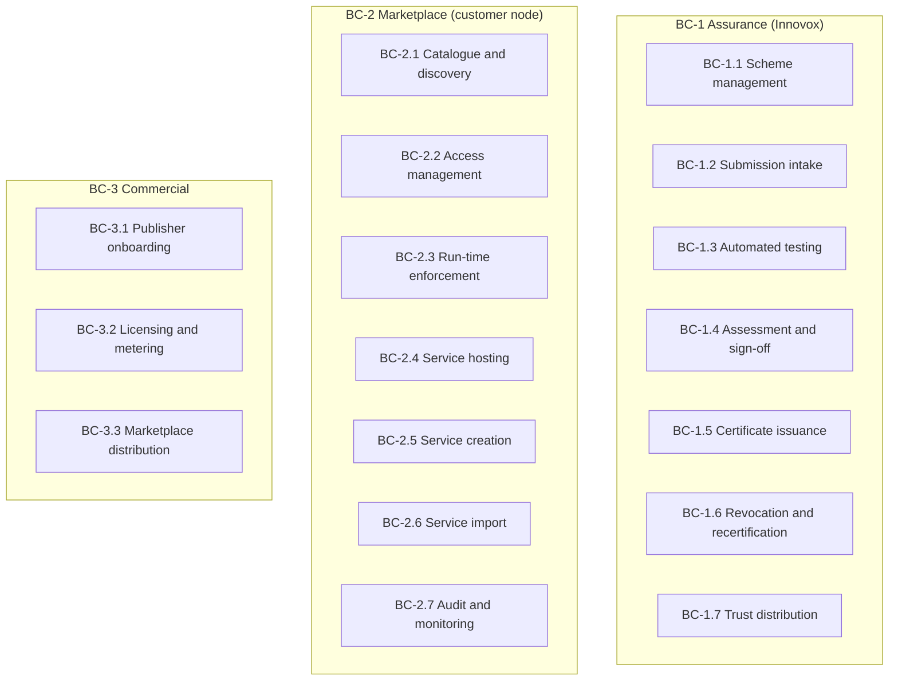
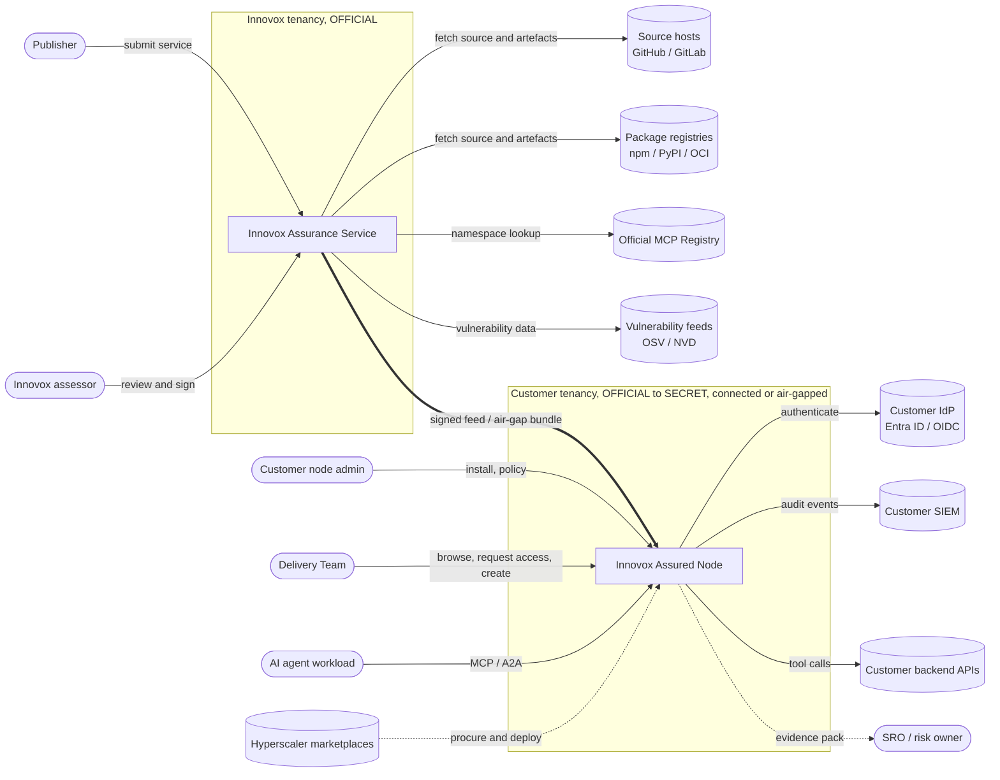
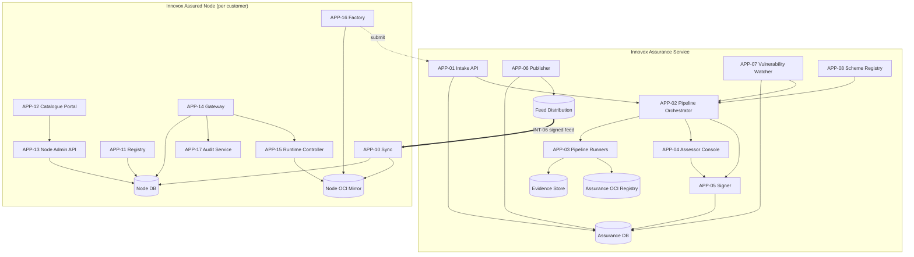
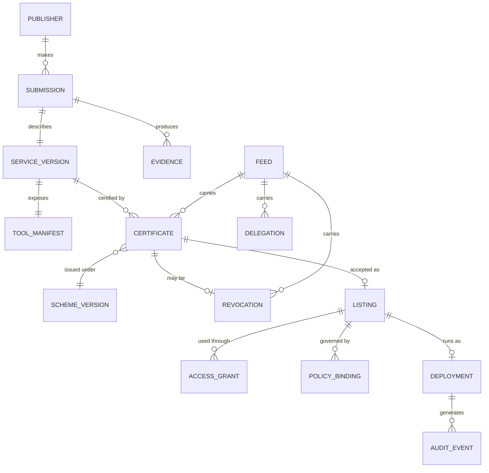
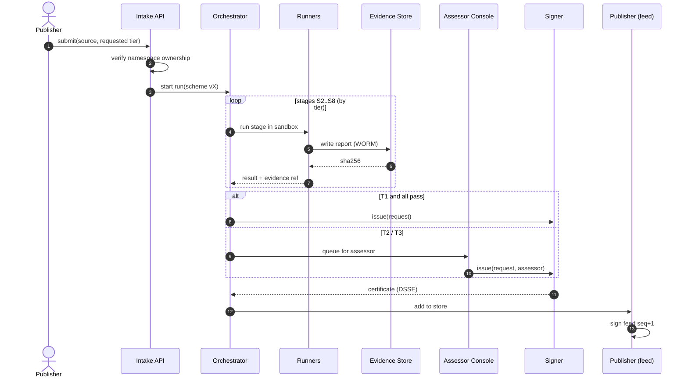
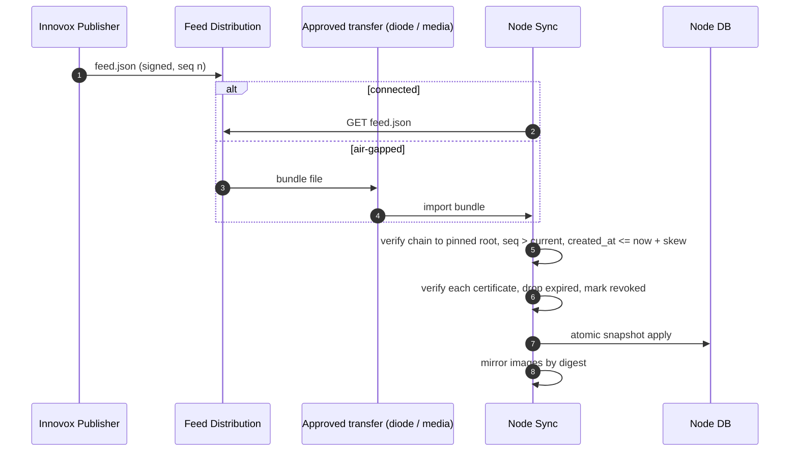
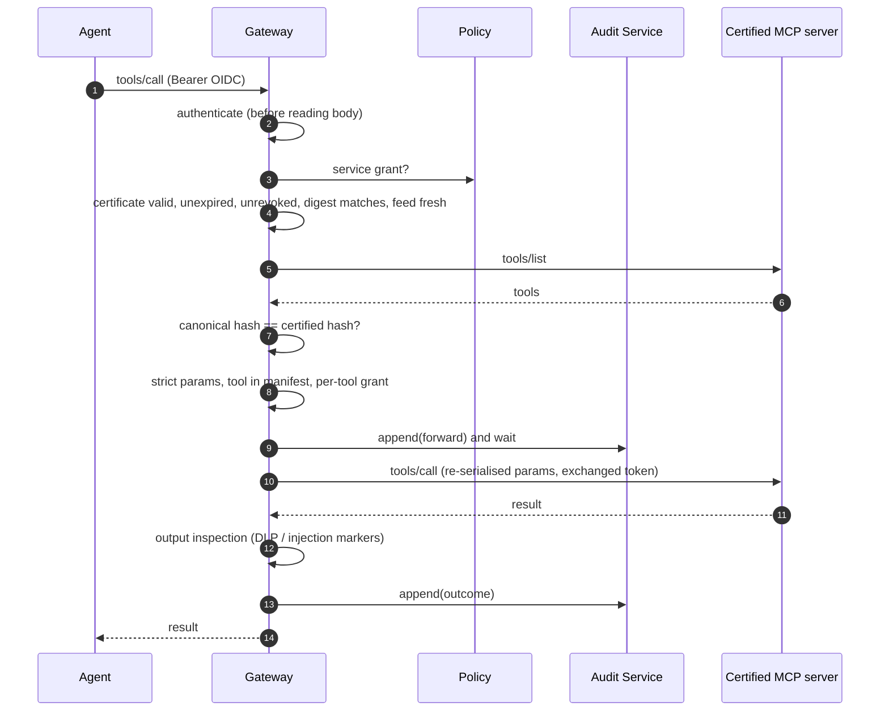
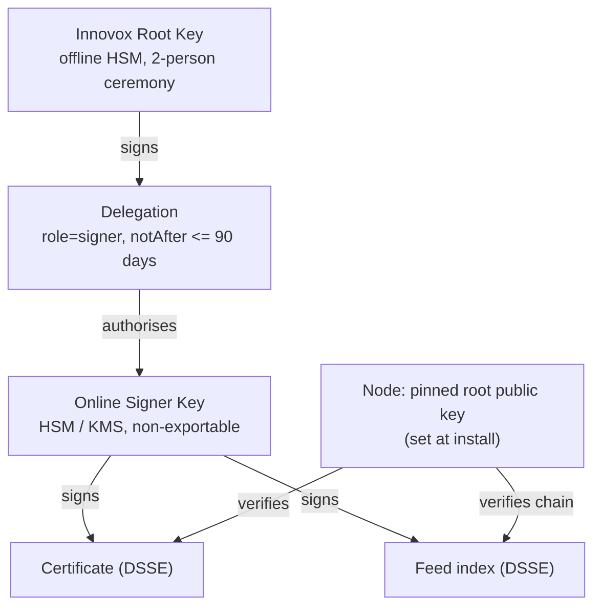
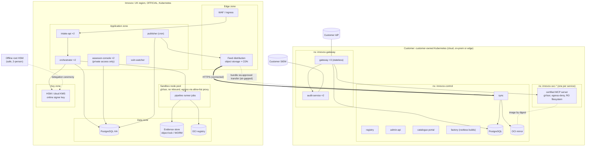

# Innovox Assured — Solution Architecture

| | |
|---|---|
| **Document** | Solution Architecture Description (SAD) |
| **Version** | 0.1, draft for review |
| **Date** | 12 November 2026 |
| **Owner** | Martin Sharkey, Innovox.uk |
| **Status** | Baseline target architecture. The section on implementation status (§14) records what has been built. |
| **Related** | [Design spec](../superpowers/specs/2026-11-11-innovox-assurance-marketplace-design.md) · [Plan 1](../superpowers/plans/2026-11-12-plan-1-trust-chain.md) |

---

## Contents

1. [Purpose and outcomes](#1-purpose-and-outcomes)
2. [Scope](#2-scope)
3. [Drivers, principles and constraints](#3-drivers-principles-and-constraints)
4. [Business architecture](#4-business-architecture)
5. [Context view](#5-context-view)
6. [Logical architecture](#6-logical-architecture)
7. [Data architecture](#7-data-architecture)
8. [Interface architecture](#8-interface-architecture)
9. [Key flows](#9-key-flows)
10. [Security architecture](#10-security-architecture)
11. [Physical architecture](#11-physical-architecture)
12. [Non-functional requirements](#12-non-functional-requirements)
13. [Operations and service management](#13-operations-and-service-management)
14. [Implementation status and roadmap](#14-implementation-status-and-roadmap)
15. [Architecture decisions](#15-architecture-decisions)
16. [Risks, assumptions, issues and dependencies](#16-risks-assumptions-issues-and-dependencies)
17. [Glossary](#17-glossary)

Element identifiers (`BC-`, `APP-`, `INT-`, `DO-`, `TC-`) follow LeanIX fact-sheet types, so this document can be loaded into an enterprise architecture repository without reinterpretation.

---

## 1. Purpose and outcomes

### 1.1 The problem

UK Defence wants to use AI agents. Agents become useful when they can call tools: MCP servers that reach data and systems, and A2A agents that perform tasks. Today every Delivery Team that wants to connect an agent to a tool faces the same unanswered questions:

- **Where does this tool come from, and who built it?** Public MCP catalogues verify who publishes a server, not whether it is safe. Malicious MCP packages and poisoned tool descriptions have been seen in the wild.
- **Will it still behave tomorrow the way it did when we tested it?** An MCP server can change its tool descriptions at any time (a "rug pull"), and those descriptions are instructions to the model.
- **What evidence can we give the SRO?** MOD Secure by Design and JSP 936 put the risk decision with MOD, but the evidence has to come from somewhere, and nobody produces it per tool.
- **How do we run it safely at OFFICIAL-SENSITIVE and above, including disconnected?**

No MOD or NCSC scheme certifies individual MCP servers or A2A agents. No commercial catalogue tests them against UK government guidance.

### 1.2 What Innovox Assured is

Innovox Assured is two things working together:

1. **An assurance service.** Innovox tests MCP servers and A2A agents against its published **Innovox Assured scheme** and issues a signed certificate. The certificate binds the exact artefact and the exact tool definitions to tiered evidence mapped to MOD and NCSC guidance.
2. **A marketplace node.** Each Defence customer runs a node in their own environment. It lets them discover certified services, import or create new ones, connect agents to them, and enforce at run time that only what was certified actually runs.

### 1.3 Outcomes

| # | Outcome | Measure |
|---|---|---|
| O1 | Delivery Teams can adopt agent tools with evidence their SRO can use | An evidence pack exists per certified service version; SRO accepts it into the Secure by Design risk record |
| O2 | Nothing uncertified, changed or revoked reaches an agent | 100% of gateway calls are checked against a valid certificate; rug pulls are blocked in under 1 s |
| O3 | Teams can bring their own APIs and open-source tools | OpenAPI-to-MCP and import paths both end in certification |
| O4 | One product works at OFFICIAL, above OFFICIAL and disconnected | The same signed images and the same bundle format are used in every environment |
| O5 | Innovox can operate the scheme as a business | Certification throughput, recertification and revocation are operable by a small team |

### 1.4 What Innovox Assured is not

It is not MOD accreditation, Secure by Design approval, JSP 936 approval, DEFCON 658 evidence or an NCSC certification. The customer's SRO remains the risk owner. The only public claim the product makes is:

> *Independently tested by Innovox against the Innovox Assured scheme vX, with signed evidence mapped to MOD and NCSC guidance.*

This wording is a constant in the code (`pkg/attest.ClaimText`) and is the only claim shown in any portal or evidence pack.

---

## 2. Scope

| In scope | Out of scope |
|---|---|
| Assurance scheme and its machine-readable control mapping | MOD accreditation, risk acceptance or JSP 936 approval |
| Certification of MCP servers (local and remote) and A2A agents | Certifying LLMs or foundation models themselves |
| Customer node: catalogue, registry, gateway, runtime, factory, audit, sync | Hosting customer agents, or orchestration of agent workflows |
| OpenAPI-to-MCP generation and import of open-source servers | General API management for non-agent traffic |
| Connected and disconnected (air-gapped) operation | Running Innovox infrastructure above OFFICIAL |
| Packaging for hyperscaler marketplaces | Billing integration with MOD finance systems |

---

## 3. Drivers, principles and constraints

### 3.1 Drivers

| ID | Driver |
|---|---|
| D-1 | MOD Secure by Design (ISN 2023/09) makes the SRO the risk owner and requires evidence from suppliers |
| D-2 | JSP 936 requires AI-specific evidence: hazard analysis, operating conditions, provenance, testing and drift checks |
| D-3 | Agentic AI guidance from Five Eyes and NCSC (May 2026): short-lived credentials, least privilege, unified audit, human ownership, the ability to stop an agent |
| D-4 | Supply-chain attacks on MCP and npm ecosystems in 2025–26, some carrying valid provenance |
| D-5 | Defence needs disconnected and classified operation |
| D-6 | Procurement routes favour packaged, cloud-agnostic products (hyperscaler marketplaces, Commercial X) |

### 3.2 Architecture principles

| ID | Principle | Implication |
|---|---|---|
| P-1 | **Fail closed** | Any verification, lookup, policy or audit failure denies the request |
| P-2 | **Certify the exact thing that runs** | A certificate binds the image digest and the canonical tool-manifest hash; any change invalidates it |
| P-3 | **Separate certifying from operating** | Innovox certifies centrally; customers operate their own nodes; no shared tenancy; customer traffic never reaches Innovox |
| P-4 | **One product, every classification** | The same signed images and bundle format, whether connected or air-gapped |
| P-5 | **Evidence over assertion** | Every claim is backed by a signed, hashed, machine-readable artefact |
| P-6 | **Least privilege everywhere** | Per-tool grants, short-lived audience-scoped tokens, outbound network denied by default |
| P-7 | **Build the product, reuse the primitives** | Innovox builds every product component; protocol SDKs, cryptography and scanners are standard |
| P-8 | **Auditable by construction** | Every decision is written to a hash-chained log before any effect happens |

### 3.3 Constraints

| ID | Constraint |
|---|---|
| C-1 | Claims must not exceed the scheme (§1.4) |
| C-2 | Customer nodes must run on customer-owned Kubernetes, including fully disconnected |
| C-3 | Innovox infrastructure handles OFFICIAL only; nothing classified above that is sent to Innovox |
| C-4 | Must follow MCP spec evolution (2026-07-28: stateless, `server/discover`) and A2A v1.0 |
| C-5 | Small team: the operating model must be automated by default |

---

## 4. Business architecture

### 4.1 Business capability map

### 4.2 Actors

| Actor | Organisation | Role |
|---|---|---|
| **Publisher** | Vendor, SME, open-source maintainer or customer team | Submits a service for certification |
| **Assessor** | Innovox, kept separate from consulting | Reviews evidence, signs Tier 2 and Tier 3, revokes |
| **Scheme owner** | Innovox | Maintains the scheme, its control mapping and its versions |
| **Key custodian** | Innovox, two-person rule | Holds the offline root key; runs key ceremonies |
| **Node administrator** | Customer | Installs the node, accepts listings, sets policy |
| **Service consumer** | Customer Delivery Team | Browses the catalogue, requests access, connects agents |
| **Agent** | Customer workload | Calls tools through the gateway with its own identity |
| **Risk owner (SRO)** | Customer | Consumes evidence into the Secure by Design and JSP 936 decision |
| **Security operations** | Customer | Receives audit logs and alerts in their SIEM |

### 4.3 Value streams

| VS | Name | Stages |
|---|---|---|
| VS-1 | **Certify a service** | Submit → verify ownership → test → assess → sign → publish |
| VS-2 | **Adopt a service** | Sync → accept listing → request access → approve → connect agent |
| VS-3 | **Bring your own API** | Upload OpenAPI → select operations → generate → certify → deploy |
| VS-4 | **Import an open-source server** | Choose from the public registry → mirror → rebuild → certify → deploy |
| VS-5 | **Respond to a vulnerability** | CVE matched to an SBOM → recertify or revoke → nodes block within one sync |
| VS-6 | **Stop an agent** | Operator triggers the kill switch → all calls denied → audit record |

### 4.4 Assurance tiers

| Tier | Name | Pipeline stages | Sign-off | Validity |
|---|---|---|---|---|
| T1 | Assessed | S1–S5 and automated S6 | Automatic | 12 months |
| T2 | Assured | S1–S8 | Assessor | 12 months |
| T3 | Mission | T2 plus manual penetration test and red-team | SC/DV-cleared assessor | 6 months |

Remote endpoints that cannot be rebuilt are capped at T1 and labelled **Remote – attested**.

---

## 5. Context view

**The only connection between the two planes is the signed feed.** It flows one way, from Innovox to the customer. It can be pulled over HTTPS or carried across an air gap as a single file. Nothing flows back unless the customer chooses to submit a service for certification.

---

## 6. Logical architecture

### 6.1 Overview

### 6.2 Assurance Service components

| ID | Component | Responsibility | Key interfaces | State |
|---|---|---|---|---|
| APP-01 | **Intake API** | Accepts a submission (`repo`, `image`, `remote`, `openapi`, `agentcard`). Verifies namespace ownership through DNS, HTTP or GitHub OIDC. Records the requested tier and the publisher's declarations. | INT-01 | Assurance DB |
| APP-02 | **Pipeline Orchestrator** | Turns a submission into a run of stages S1–S9, schedules runner jobs, enforces per-stage time and resource limits, gathers results, and routes to sign-off by tier. The rules are versioned with the scheme. | INT-02, INT-03 | Assurance DB |
| APP-03 | **Pipeline Runners** | Disposable, sandboxed jobs, one per stage: provenance check, rebuild, SAST, SCA, SBOM, secrets scan, MCP static checks, manifest pinning, protocol and auth tests, behavioural trace, AI red-team. No inbound network. Outbound only during S2 and the build, through an allow-listing proxy. | INT-03 | Evidence Store, Assurance OCI |
| APP-04 | **Assessor Console** | Review queue, evidence viewer, sign or reject with reasons, revocation, decision log. Enforces separation of duties: an assessor cannot sign a service they consulted on. | INT-04 | Assurance DB |
| APP-05 | **Signer** | Builds the in-toto Statement with the certificate predicate and signs it as DSSE using the online signing key held in an HSM or KMS. Enforces the tier rules. | internal gRPC | — |
| APP-06 | **Publisher** | Produces the signed, monotonic feed index (certificates, delegations, revocations) and the air-gap bundle, and distributes them. Runs at least daily so nodes never go stale. | INT-06 | Feed Distribution |
| APP-07 | **Vulnerability Watcher** | Matches new CVEs and advisories against stored SBOMs. Opens recertification or revocation cases. Re-checks the manifest hash of remote endpoints daily. | INT-07 | Assurance DB |
| APP-08 | **Scheme Registry** | Versioned scheme text, controls and the mapping to Secure by Design, JSP 936, ETSI EN 304 223, the Software Security Code of Practice, OWASP and CoSAI. Drives pipeline thresholds and evidence-pack rendering. | INT-05 | Git-backed |

### 6.3 Customer Node components

| ID | Component | Responsibility | Key interfaces | State |
|---|---|---|---|---|
| APP-10 | **Sync** | Pulls the feed or imports a bundle. Verifies it against the pinned root (rejecting replayed, forged or future-dated feeds). Verifies each certificate and mirrors images by digest. Applies the snapshot atomically. | INT-06, INT-12 | Node DB, Node OCI |
| APP-11 | **Registry** | MCP Registry API (read subset) and an A2A Agent Card registry. Lists only verified and accepted items plus local entries, so existing MCP clients can discover through it. | INT-09 | Node DB |
| APP-12 | **Catalogue Portal** | Web UI to browse by capability, tier and classification; view the evidence summary and claim; request access; approve as an admin; manage policy; trigger the kill switch. | INT-10 | via APP-13 |
| APP-13 | **Node Admin API** | Listings, access requests and grants, policy bindings, upstream deployments and the kill switch. The single write path for node configuration. | INT-10 | Node DB |
| APP-14 | **Gateway** | The single MCP and A2A entry point. Authenticates the caller, checks the service grant and certificate (validity, expiry, revocation, digest), checks the manifest hash on every list and call, applies per-tool policy, exchanges tokens, inspects arguments and outputs, holds high-impact calls for human approval, and writes audit before forwarding. | INT-08 | stateless |
| APP-15 | **Runtime Controller** | Deploys certified images, by digest only, into sandboxed namespaces (gVisor, outbound denied by default, read-only filesystem, no service account token). Reports the running digest to the gateway and refuses any image without a matching certificate. | Kubernetes API | Node DB |
| APP-16 | **Factory** | Creates MCP servers from OpenAPI (allow-listed operations, typed schemas, token-exchange auth) and imports from the public registry or a repo (mirror, pin, rebuild). Builds are reproducible and rootless. Output goes to certification only, never straight to a listing. | INT-11, INT-01 | Node OCI |
| APP-17 | **Audit Service** | Receives decision events from all gateway replicas. Keeps one hash chain per writer with signed periodic checkpoints. Exports to the SIEM. Provides verification. | INT-13, INT-14 | Audit store |

### 6.4 Shared libraries (implemented in Plan 1)

| Package | Purpose |
|---|---|
| `pkg/manifest` | RFC 8785 canonicalisation; tool-manifest and Agent Card hashing; rejects duplicate keys; never normalises Unicode |
| `pkg/attest` | DSSE envelopes; in-toto Statement; certificate predicate; claim text |
| `pkg/trust` | Key IDs; root-to-signer delegation; keyring |
| `pkg/feed` | Feed index, revocations, certificate digest, bundle I/O |
| `pkg/mcpx` | MCP JSON-RPC types and client (to be replaced by the official SDK) |

---

## 7. Data architecture

### 7.1 Data objects

| ID | Data object | Owner | Plane | Classification (typical) | Retention |
|---|---|---|---|---|---|
| DO-01 | Publisher | Innovox | Assurance | OFFICIAL | Life of account + 6 years |
| DO-02 | Submission | Innovox | Assurance | OFFICIAL | 6 years |
| DO-03 | ServiceVersion | Innovox | Both | OFFICIAL | Indefinite |
| DO-04 | ToolManifest (canonical JSON + hash) | Innovox | Both | OFFICIAL | Indefinite |
| DO-05 | Evidence item (report, hash, stage, tool version) | Innovox | Assurance | OFFICIAL | 6 years after expiry |
| DO-06 | Certificate (DSSE envelope) | Innovox | Both | OFFICIAL | Indefinite |
| DO-07 | Revocation | Innovox | Both | OFFICIAL | Indefinite |
| DO-08 | Delegation (root → signer) | Innovox | Both | OFFICIAL | Indefinite |
| DO-09 | Feed index / bundle | Innovox | Both | OFFICIAL | Last 100 versions |
| DO-10 | SBOM (CycloneDX) | Innovox | Assurance | OFFICIAL | 6 years after expiry |
| DO-11 | Scheme version and control mapping | Innovox | Assurance | OFFICIAL | Indefinite |
| DO-12 | Listing | Customer | Node | Per node | Life of node |
| DO-13 | AccessGrant | Customer | Node | Per node | Life of grant + 1 year |
| DO-14 | PolicyBinding | Customer | Node | Per node | Life of node |
| DO-15 | Deployment (service, digest, namespace) | Customer | Node | Per node | Life of node |
| DO-16 | AuditEvent | Customer | Node | Per node, up to node classification | Customer policy (default 2 years) |
| DO-17 | Node trust state (pinned root, seq, feed time) | Customer | Node | Per node | Life of node |

### 7.2 Conceptual model

### 7.3 The certificate (DO-06)

A DSSE envelope (`payloadType: application/vnd.in-toto+json`) wraps an in-toto Statement v1 with:

- `subject`: the image digest (`sha256`), or `remote:<url>` with the manifest hash as digest.
- `predicateType`: `https://innovox.uk/attestation/certificate/v1`
- `predicate`:
  - `scheme_version` and `tier`
  - `service {name, version, kind}`
  - `manifest_sha256`
  - `evidence[] {stage, result, sha256}`
  - `issued_at` and `expires_at`
  - `assessor` and `claims_mapping_ref`

The **certificate digest** (SHA-256 of the payload) is the identifier used for revocation.

### 7.4 Data handling rules

- Customer agent traffic, tool arguments and tool results never leave the customer node.
- Evidence is stored write-once. Every item is hashed, and the hash is in the certificate, so evidence cannot be swapped after signing.
- Nodes above OFFICIAL take data in only (the feed). No telemetry flows back to Innovox from a disconnected node.
- Audit events may contain classified detail and inherit the node's classification. The gateway clips logged fields so audit cannot be used to exfiltrate payloads.

---

## 8. Interface architecture

| ID | Interface | Provider → Consumer | Protocol | AuthN | Notes |
|---|---|---|---|---|---|
| INT-01 | Submission API | APP-01 ← Publisher, APP-16 | HTTPS REST/JSON | OIDC (publisher org) + mTLS for factory | Idempotent submit; status polling and webhooks |
| INT-02 | Orchestration events | APP-02 ↔ APP-03 | Internal queue | Workload identity (SPIFFE) | One job per stage |
| INT-03 | Evidence write | APP-03 → Evidence Store | Object storage API | Workload identity | Write-once; returns hash |
| INT-04 | Assessor API | APP-04 ← Assessors | HTTPS + web UI | Innovox IdP with MFA; cleared roles for T3 | Every action is decision-logged |
| INT-05 | Scheme API | APP-08 → APP-02, evidence renderer | Git / read API | Internal | Scheme is versioned; changes trigger recertification |
| INT-06 | **Feed** | APP-06 → APP-10 | HTTPS GET of a static file, or bundle file | Ed25519 signature chain to pinned root | One way; monotonic `seq`; snapshot semantics |
| INT-07 | Vulnerability intake | OSV/NVD → APP-07 | HTTPS | — | Mirrored for the assurance plane only |
| INT-08 | **Gateway MCP/A2A** | APP-14 ← Agents | MCP streamable HTTP; A2A JSON-RPC | Customer OIDC (RFC 8693 token exchange) | Route `/mcp/{name}@{version}`; fail-closed |
| INT-09 | Registry API | APP-11 ← MCP clients | MCP Registry API v0 (read) | Customer OIDC | Lets standard clients discover via the node |
| INT-10 | Node Admin API | APP-13 ← Portal, automation | HTTPS REST/JSON | Customer OIDC, admin roles | Single write path for configuration |
| INT-11 | Factory API | APP-16 ← Portal | HTTPS REST/JSON | Customer OIDC | OpenAPI upload, operation selection, import |
| INT-12 | Image mirror | APP-10 → Node OCI | OCI distribution | Node-internal | Pull by digest only |
| INT-13 | Audit ingest | APP-14 → APP-17 | gRPC, synchronous append | mTLS | Gateway waits for the append before forwarding |
| INT-14 | SIEM export | APP-17 → customer SIEM | Syslog/CEF or HTTPS JSON | Customer-defined | Includes chain checkpoints |

---

## 9. Key flows

### 9.1 VS-1: Certify a service

### 9.2 VS-2: Publish and sync, connected and air-gapped

### 9.3 VS-2: Agent calls a certified tool

### 9.4 Rug pull and revocation

1. The server changes a tool description after certification.
2. On the next `tools/list` or `tools/call`, the gateway's hash no longer matches. It denies the call (`rug_pull`), raises an alert, and the call never reaches the server.
3. The node reports the alert to the customer's SOC. If the customer chooses to report it to Innovox, an assessor revokes the certificate.
4. The next feed carries the revocation. Every node that syncs denies the service, and replaying an older feed is rejected.

### 9.5 VS-3: Bring your own API

1. The user uploads an OpenAPI 3.x document and selects operations.
2. The Factory generates a Python MCP server. It creates one tool per operation, with the input schema derived from the operation's parameters and body, and uses token exchange to call the backend.
3. A reproducible, rootless build pushes the image to the node mirror.
4. The image is submitted for certification. In disconnected nodes, Tier 1 can run locally under a **customer-local signing key**: the node trusts that key only for its own listings, never for feed content.
5. Once certified, the Runtime Controller deploys it and the service is listed.

### 9.6 VS-5: Respond to a vulnerability

The Vulnerability Watcher matches a new CVE to stored SBOMs, then acts by severity:

- **Critical:** revoke automatically, pending assessor review, and publish within 4 hours.
- **Otherwise:** open a recertification case. The publisher has 30 days to ship a fixed version.

---

## 10. Security architecture

### 10.1 Trust model

- The root never signs certificates or feeds, and nodes refuse it if it tries.
- **Target state (Plan 5):** a root-signed revocation list for signer keys, plus a ceiling on sequence-number jumps. Until then, delegations are kept to 90 days or less.
- **Root rotation:** the old root signs a statement naming the new root, which nodes accept during a one-year overlap.

### 10.2 Threats and controls

| Threat | Example | Control | Where |
|---|---|---|---|
| Tool poisoning | Hidden instructions in a description | S4 static checks; certified manifest hash | Pipeline, Gateway |
| Rug pull | Description changes after certification | Hash re-check on every list and call | Gateway |
| Hidden tool | Server executes a tool not advertised | Deny calls to tools not in the verified manifest | Gateway |
| Parser differential | `{"name":"a","NAME":"b"}` | Strict params; duplicate keys rejected; re-serialised forward | Gateway, manifest |
| Supply-chain compromise | Malicious dependency with valid provenance | Provenance policy pins repo, builder and workflow; rebuild; SCA; SBOM watch | Pipeline |
| Instruction channel | `initialize.instructions` | Stripped by the gateway | Gateway |
| Token misuse | Passthrough, confused deputy | RFC 8693 exchange; audience binding; S6 tests | Gateway, Pipeline |
| Replay or rollback | Old feed re-applied | Monotonic `seq`; atomic apply | Sync |
| Clock abuse | Future-dated feed to extend the grace period | Reject `created_at` beyond now + 5 min | Sync |
| Stale revocation | Node cut off from updates | Grace period based on feed age (7 days default), then deny all | Sync, Gateway |
| Audit tampering | Edit or delete events | Hash chain; signed checkpoints; append before forward | Audit |
| Anonymous DoS of audit | Oversized payloads | Authenticate before parsing; clip fields | Gateway |
| Sandbox escape | Malicious server breaks out | gVisor; outbound denied; read-only filesystem; no service-account token | Runtime |
| Insider certification | Assessor certifies own work | Separation of duties; decision log; two-person rule for T3 | Assessor Console |

### 10.3 Mapping to guidance (summary)

| Guidance | How the product supports it |
|---|---|
| MOD Secure by Design (principles on supply chain, secure development, monitoring) | Evidence pack per service version; SBOM; provenance; audit export for monitoring |
| JSP 936 (AI assurance artefacts) | Operating conditions (declared tools and scope), provenance, red-team and regression testing, drift detection through manifest pinning |
| Five Eyes / NCSC agentic AI guidance | Short-lived scoped tokens, least privilege, unified audit, human approval for high-impact calls, kill switch |
| ETSI EN 304 223 | Lifecycle controls mapped in the scheme (APP-08) |
| DSIT/NCSC Software Security Code of Practice | Secure development and vulnerability handling evidence from the pipeline |
| OWASP MCP Top 10 / Agentic Top 10, CoSAI | Pipeline S4–S8 and the gateway controls above |

The authoritative mapping lives in `scheme/` (APP-08) and is versioned with each certificate (`claims_mapping_ref`).

### 10.4 Identity and access

- **Innovox staff** use the Innovox IdP with MFA and role-based access: publisher, assessor (BPSS/SC), T3 assessor (SC/DV), scheme owner and key custodian.
- **Customers** use their own OIDC provider. Roles are node admin, approver, consumer and auditor. Agents authenticate as workloads with their own identity, never a shared token.
- **Services:** inside the Innovox plane, service-to-service traffic uses SPIFFE workload identity with mTLS. Upstream calls use exchanged, audience-scoped tokens with a lifetime of 5 minutes or less.

---

## 11. Physical architecture

### 11.1 Deployment overview

### 11.2 Environments

| Environment | Where | Purpose |
|---|---|---|
| Assurance-dev / test | Innovox tenancy | Development, pipeline tuning against the malicious fixture corpus |
| Assurance-prod | Innovox tenancy, UK region | Live certification and feed |
| Node reference | Innovox tenancy | Demo and pilot node at OFFICIAL with synthetic data |
| Customer node (connected) | Customer cloud, e.g. MODCloud, Google Distributed Cloud or Defence Digital Foundry | Production use at OFFICIAL / OFFICIAL-SENSITIVE |
| Customer node (disconnected) | Customer enclave, above OFFICIAL | Bundle-fed; Tier 1 local certification of factory output only |

### 11.3 Deployment units

| Unit | Image | Replicas (min) | Scaling | Notes |
|---|---|---|---|---|
| intake-api | `innovox/intake` | 2 | CPU | Public behind WAF |
| orchestrator | `innovox/orchestrator` | 2 | Queue depth | Leader election for scheduling |
| pipeline runner | `innovox/runner-<stage>` | 0 | Jobs | Per-stage images; scanners pinned by digest |
| assessor-console | `innovox/console` | 2 | — | Private network only |
| signer | library in orchestrator / console, key in HSM | — | — | No key material on disk |
| publisher | `innovox/publisher` | cron | — | At least daily; on demand after revocation |
| sync | `innovox/node-sync` | 1 | — | Single writer for trust state |
| gateway | `innovox/gateway` | 3 | RPS / CPU | Stateless; reads state from Node DB with a short cache; fails closed if unavailable |
| audit-service | `innovox/audit` | 2 | — | One chain per writer; signed checkpoints every 5 min |
| registry, admin-api, portal | `innovox/node-*` | 2 | — | — |
| factory | `innovox/factory` | 1 | Jobs | Rootless BuildKit |
| runtime controller | `innovox/runtime` | 1 | — | Kubernetes operator; admits images only with a matching certificate |

All images are built reproducibly, signed, accompanied by SBOMs, and **certified by the scheme itself**, so the product holds its own components to the standard it applies to others.

### 11.4 Packaging

- **Helm chart** `innovox-node` with three profiles: `connected`, `disconnected` and `edge`.
- **Offline bundle:** a single archive containing every image (by digest), the chart, the root public key and the latest feed, for air-gapped installs.
- **Hyperscaler listings:** the same chart and images as private offers. Nothing changes per cloud except storage and KMS bindings.

### 11.5 Technology components

| ID | Component | Use | Status |
|---|---|---|---|
| TC-01 | Go 1.24 | All services | In use |
| TC-02 | TypeScript / React | Catalogue portal, Assessor Console | Planned |
| TC-03 | Python + official MCP SDK | Factory-generated servers | Planned |
| TC-04 | PostgreSQL 16 | Assurance DB, Node DB | Planned (files used in Plan 1) |
| TC-05 | OCI registry | Artefacts, evidence, mirror | Planned |
| TC-06 | Kubernetes 1.30+, gVisor | Hosting, sandbox | Planned |
| TC-07 | OPA | Gateway policy | Planned (grant table in Plan 1) |
| TC-08 | Sigstore / cosign; HSM / KMS | Signing | Planned (Ed25519 DSSE in Plan 1) |
| TC-09 | Semgrep, CodeQL, Syft, Grype, OSV-Scanner, Trivy, Cisco mcp-scanner, garak, promptfoo | Pipeline stages | Planned |
| TC-10 | SPIFFE/SPIRE | Workload identity | Planned |
| TC-11 | OpenTelemetry | Metrics and traces | Planned |

---

## 12. Non-functional requirements

All values are targets for the pilot unless stated.

| Category | Requirement |
|---|---|
| **Gateway latency** | Overhead ≤ 30 ms p95 per call, excluding upstream time, with the manifest-hash re-check cached per upstream for ≤ 5 s and invalidated by `tools/list_changed` |
| **Gateway throughput** | 500 requests/s per replica |
| **Availability** | Gateway 99.9% per node; feed distribution 99.5%; the certification pipeline is not time-critical (99%) |
| **Revocation latency** | Critical revocation published ≤ 4 h; enforced by connected nodes within one sync interval (default 15 min) |
| **Certification time** | T1 ≤ 2 h automated; T2 ≤ 5 working days; T3 by engagement |
| **Recovery** | Assurance RPO 15 min / RTO 4 h. Node RPO 15 min / RTO 1 h. The gateway fails closed while recovering. |
| **Scalability** | 5,000 certified service versions; 200 nodes; 10,000 agents per node |
| **Security** | Fail closed throughout; FIPS-approved algorithms where a customer requires them; no secrets in images or the repo |
| **Auditability** | 100% of gateway decisions logged before effect; chain verifiable offline |
| **Portability** | No cloud-specific dependency in node images; storage and KMS are pluggable |
| **Accessibility** | Portals meet WCAG 2.2 AA |
| **Supportability** | Structured logs, OpenTelemetry metrics, health endpoints; upgrades without downtime for the gateway |

---

## 13. Operations and service management

- **Monitoring:**
  - **Assurance plane:** pipeline queue depth, stage failure rates, signer usage, feed age.
  - **Nodes:** deny rate by reason, rug-pull alerts, feed age against the grace period, audit-chain verification status.
- **Key management:** quarterly signer-key rotation. Root ceremonies are recorded and witnessed, and HSM audit logs are retained.
- **Incident response:** suspected signer compromise triggers four steps:
  1. Revoke the delegation, which needs the Plan 5 mechanism.
  2. Publish an emergency feed.
  3. Notify customers.
  4. Re-sign valid certificates under a new key.
- **Releases:** the product is certified under its own scheme, every release has an SBOM, and customers get the offline bundle for each release.
- **Support model:**
  - **Innovox runs:** the assurance plane.
  - **Customers run:** their own nodes. Innovox provides third-line support under contract.
  - **Separation:** support never requires access to customer data.

---

## 14. Implementation status and roadmap

### 14.1 Status by component

| Component | Status | Code |
|---|---|---|
| Canonical hashing (`pkg/manifest`) | ✅ Built, tested | `pkg/manifest` |
| Certificates and DSSE (`pkg/attest`) | ✅ Built, tested | `pkg/attest` |
| Key hierarchy (`pkg/trust`) | ✅ Built, tested; signer-key revocation outstanding | `pkg/trust` |
| Signer (APP-05) | ✅ Core built; HSM/KMS outstanding | `assurance/signer`, `cmd/innovox-sign` |
| Publisher (APP-06) | ✅ File-store version built | `assurance/publisher`, `cmd/innovox-publish` |
| Sync (APP-10) | ✅ Built (file state) | `node/syncer`, `cmd/innovox-sync` |
| Gateway (APP-14) | 🟡 Enforcement core built. Outstanding: token exchange, output inspection, human approval, kill switch, OIDC, OPA, SSE and sessions | `node/gateway`, `cmd/innovox-gateway` |
| Audit (APP-17) | 🟡 Single-writer file chain built. Outstanding: service, multi-writer, checkpoints, SIEM export | `node/audit` |
| Intake, Orchestrator, Runners, Console, Watcher, Scheme | ⬜ Not started | — |
| Registry, Portal, Admin API, Runtime Controller, Factory | ⬜ Not started | — |
| Helm, offline bundle, marketplace packaging | ⬜ Not started | — |

### 14.2 Roadmap

| Plan | Delivers | Depends on |
|---|---|---|
| **1 — Trust chain** ✅ | Certificates, feed, sync, gateway enforcement core, audit chain | — |
| **2 — Node service foundation** | PostgreSQL schema and migrations; Node Admin API; Registry (MCP Registry API read subset); gateway reads state from the DB; Audit Service with checkpoints and SIEM export; OIDC; OPA; kill switch; OpenTelemetry | 1 |
| **3 — Assurance service foundation** | Intake API; Orchestrator; runner framework with stages S1–S5 and automated S6; Evidence Store; Scheme Registry; publisher on the DB; HSM/KMS signer | 1 |
| **4 — Full pipeline and assessment** | S6–S8; Assessor Console with separation of duties; Vulnerability Watcher; recertification and revocation workflow; signer-key revocation | 3 |
| **5 — Runtime and factory** | Runtime Controller (gVisor, admission by certificate); Factory (OpenAPI create and import); customer-local T1 signing for disconnected nodes | 2, 3 |
| **6 — Experience and packaging** | Catalogue Portal; access-request workflow; evidence-pack rendering; Helm profiles; offline bundle; marketplace listings | 2, 4, 5 |
| **7 — Protocol completeness** | Official MCP SDK; SSE and sessions; A2A task proxying with Agent Card verification; token exchange; output inspection; human approval | 2 |

*The earlier spec numbered Plans 2–5 differently. This table supersedes it.*

---

## 15. Architecture decisions

| ADR | Decision | Rationale | Consequence |
|---|---|---|---|
| ADR-001 | Two planes: a central assurance service and per-customer nodes | Separates certifying from operating; keeps customer data local; same model at every classification | Feed is the only coupling; nodes must work offline |
| ADR-002 | Build every product component in-house; reuse SDKs, crypto and scanners | Control over the trust-critical path; simpler self-assurance | Larger build; must track upstream protocol changes |
| ADR-003 | Go for services | Static binaries suit air-gapped installs; strong standard crypto; mature MCP SDK | Portal in TypeScript; factory output in Python |
| ADR-004 | Certificates as DSSE-wrapped in-toto Statements | Standard, tool-friendly, Sigstore-compatible | Custom predicate type to publish and version |
| ADR-005 | Pin the RFC 8785 canonical tool-manifest hash | Detects any change in what the model sees, independent of formatting | Every description edit needs recertification (intended) |
| ADR-006 | Fail closed everywhere | Defence risk appetite; makes failures visible | Availability depends on the feed being fresh; publisher must run daily |
| ADR-007 | Tiered sign-off (T1 automatic, T2 assessor, T3 cleared assessor plus manual testing) | Scales cheaply for low-risk tools while keeping higher tiers credible | Need cleared assessors for T3 |
| ADR-008 | Offline root delegates short-lived online signer keys | Limits damage from a compromised online key | Key ceremonies; signer-key revocation required (Plan 4) |
| ADR-009 | Feed is a full snapshot with a monotonic sequence number | Simple, atomic, replay-proof, works as a file | Feed size grows with the catalogue; compress and paginate later if needed |
| ADR-010 | Containers on Kubernetes; cloud-agnostic | Runs on any customer platform and in marketplaces | Customers need a Kubernetes capability |
| ADR-011 | PostgreSQL + OCI registry + WORM object storage | Widely available, including on-prem | Operational burden on the customer for node DB |
| ADR-012 | Innovox's own mark, not an MOD certification | It is what Innovox can legitimately claim | Commercial value depends on credibility; UKAS (ISO/IEC 17065) route later |
| ADR-013 | Gateway writes the audit record before forwarding | No effect without a record | Audit Service is on the critical path and must be highly available |

---

## 16. Risks, assumptions, issues and dependencies

### Risks

| ID | Risk | L | I | Mitigation |
|---|---|---|---|---|
| R-1 | Conflict of interest (certifier also sells marketplace and consulting) undermines the mark | M | H | Separation of duties in the Console; decision log; separate legal entity or function for assessment; UKAS route |
| R-2 | Signer key compromise | L | H | HSM, short delegations, signer-key revocation (Plan 4), incident runbook |
| R-3 | MCP and A2A specs keep changing | H | M | Protocol code isolated in `pkg/mcpx`; adopt the official SDK; test against spec versions |
| R-4 | Demand for this specific product is unproven in MOD | M | H | Lead with assurance evidence for platforms MOD already runs; pilot via Commercial X |
| R-5 | A government certification scheme for the Software Security Code of Practice competes | M | M | Map the scheme to it; position the mark as agent-specific |
| R-6 | False positives in pipeline stages slow certification | M | M | Tuned rulesets; VEX acceptance by assessors; metrics per stage |
| R-7 | Customer Kubernetes maturity varies | M | M | Reference node; managed-node offer; edge profile |

### Assumptions

- **A-1:** Customers can run Kubernetes with gVisor (or an equivalent sandbox) in their environment.
- **A-2:** Customers have an OIDC provider that can issue workload identities to agents.
- **A-3:** An approved transfer mechanism exists for bringing bundles into disconnected enclaves.
- **A-4:** Publishers will accept a source rebuild for Tier 2 and above.

### Issues

- **I-1:** In Plan 1, signer-key revocation and a ceiling on sequence-number jumps are not implemented (review finding I6).
- **I-2:** In Plan 1, the gateway does not support SSE responses or MCP session headers.

### Dependencies

- MCP Registry API stability.
- The official MCP Go SDK.
- Availability of HSM or KMS in the chosen UK region.
- Customer IdP integration.

---

## 17. Glossary

| Term | Meaning |
|---|---|
| **A2A** | Agent2Agent protocol (Linux Foundation) for agents to delegate tasks to other agents |
| **Agent Card** | A2A metadata describing an agent; hashed and countersigned for certification |
| **Bundle** | Single-file signed feed for air-gapped transfer |
| **Certificate** | Innovox-signed DSSE attestation binding a service version to tier and evidence |
| **DSSE** | Dead Simple Signing Envelope: a signature format that binds payload type and payload |
| **Feed** | Signed index of certificates, delegations and revocations with a monotonic sequence number |
| **Manifest hash** | SHA-256 of the RFC 8785 canonical form of a server's tool list |
| **MCP** | Model Context Protocol: how agents discover and call tools |
| **Node** | Customer-run Innovox Assured deployment |
| **Rug pull** | A server changing its tool definitions after it has been trusted |
| **SRO** | Senior Responsible Owner, MOD's accountable risk owner |
| **Tier** | Depth of assurance: T1 Assessed, T2 Assured, T3 Mission |
