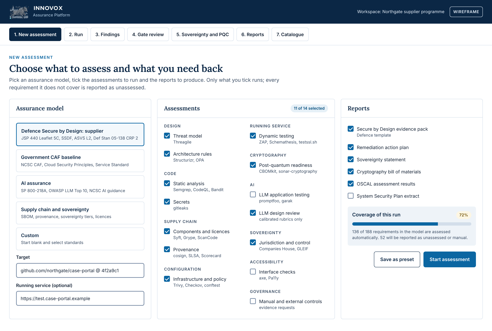
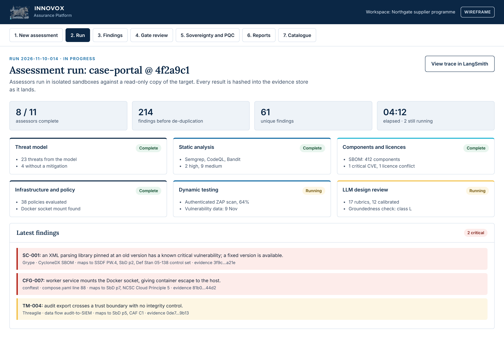
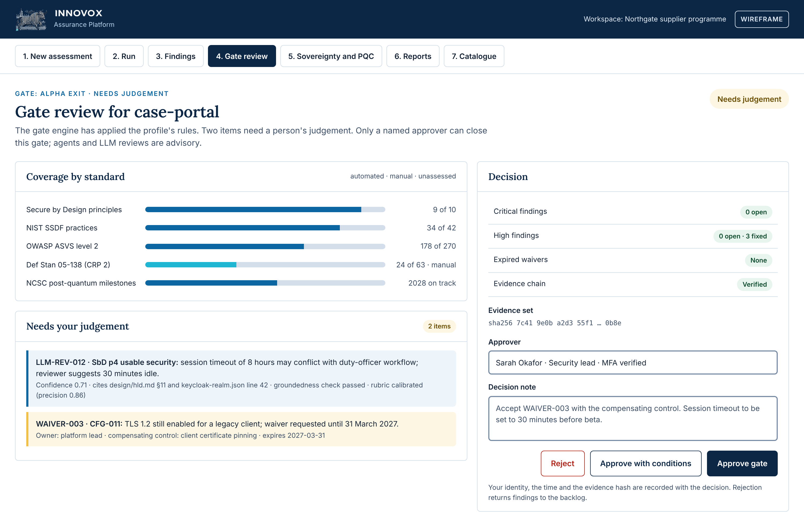
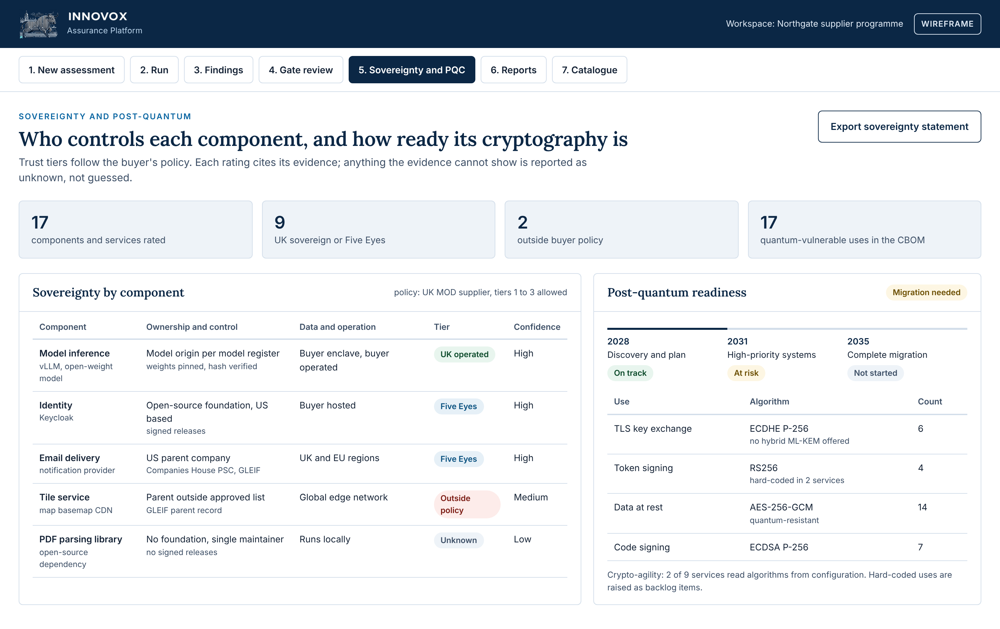

# Innovox Assurance Platform: High-Level Design

> Exported 12 November 2026 from the live document: https://claude.ai/artifact/MxjzNmL7Nn2qKmjKY5qQFu. The live document is the master copy; 3 diagram(s) appear only there.

Nov 10, 2026 · Martin Sharkey

## Executive summary

The Innovox Assurance Platform, built by Innovox Limited, turns compliance evidence from a manual, after-the-fact exercise into a continuous output of delivery. Teams building for UK government and Defence get verifiable evidence against Secure by Design, NCSC, NIST and sector standards as they work, and a named person still makes every gate decision.

**How it works**

- **Standards as data:** catalogues, crosswalks, profiles and results are held in OSCAL, so rules are versioned, diffable and machine-readable.
- **Assessors as MCP tools:** every tool runs as a signed, sandboxed MCP server with a skill that tells agents how to use it, how to read it and what it must never do.
- **Agents orchestrate, people decide:** agents plan and run assessments on DP-AI-001; LLM reviews are advisory, cited, cross-checked by a second model class and calibrated against human review before they count.
- **Tamper-evident evidence:** findings in SARIF, CycloneDX and OSCAL are written to an append-only, hashed store, tied to tool versions, target hashes and vulnerability-data dates.

**What sets it apart**

- A **sovereignty assessor** that states, with evidence, where each tool, model and supplier is owned, controlled and legally exposed, against trust tiers the buyer sets.
- A **post-quantum assessor** that builds a cryptography bill of materials and scores readiness against NCSC's 2028, 2031 and 2035 milestones.
- **Sector report templates** for Defence Secure by Design, wider government and NIST-style evidence.
- A **workspace bridge** that deploys the gates, skills and backlog into any agentic IDE workspace, so failed and rejected gates come back as backlog items.
- The platform **assesses itself** on every release, and vets every tool it wraps before adopting it.

**Where it runs.** One set of signed images and one chart serve three deployment modes: SaaS at OFFICIAL, customer tenancy through cloud marketplaces (OFFICIAL, including OFFICIAL-SENSITIVE handling where the buyer's hosting allows), and air-gapped on DP-AI-001's Sovereign profile up to SECRET, updated by dated, signed bundles.

**What it is not.** It produces self-assessment evidence packs, never certification. Every report separates automated checks from manual and external controls and shows what was not assessed.

**Next steps:** select the findings store, scope the first Defence Secure by Design supplier profile in OSCAL, and benchmark open-weight models for the air-gapped LLM review assessor.

## 1 Introduction and goals

The Innovox Assurance Platform assesses any application, design, model, tool or supply chain against a selected set of standards. It returns evidence, findings and reports that a human approver uses to pass or fail a gate. It is built as a pattern on the [DP-AI-001 LangSmith platform](https://claude.ai/artifact/GggvoDFqELnwcqwR6aDRnq), which supplies the agent runtime, model routing, sign-in, evaluation and the connected and air-gapped tiers. This document adds only what assurance needs on top.

**Scope.** Included:

- A machine-readable catalogue of standards, with crosswalks between them
- Assurance profiles
- A library of assessors, each a secure MCP server with a skill telling agents how to use it and what to report
- An assessment orchestrator built as an agent squad
- An evidence store, a gate engine with human approval, and a report generator with sector templates
- Packaging for SaaS, customer-tenancy marketplace and air-gapped deployment

The design of individual assessors beyond their contract is out of scope; each gets its own low-level design.

**Requirements basis.** Requirements are assumed, not researched: they come from seven synthetic stakeholder persona rehearsals held in an assumed requirements register. The platform is proven by Innovox on its own repositories, as set out in the build plan.

### 1.1 Purpose

Teams building software for UK government and Defence must show that it meets Secure by Design, NCSC, NIST and sector standards. Today that evidence is assembled by hand before an assessment, after the work is done. This platform produces it from the work itself, as the work happens, and makes agentic development governable: every agent-built change carries the evidence that it meets the standards its profile names.

A user picks an **assurance model** (a profile such as Defence Secure by Design or AI assurance), ticks the **assessments** to run and the **reports** to produce, and points it at a target: a repository, a design, a running service, a model or a component list. The platform runs only what was selected. Every report states which standards it did not cover.

### 1.2 Quality goals

| Priority | Goal | Measure |
| --- | --- | --- |
| 1 | Evidence integrity | Every finding traces to its requirement, its evidence and the exact tool and version that produced it; stored evidence is hashed and cannot be changed |
| 2 | Honest coverage | No report presents an unassessed requirement as met; manual and external controls are shown separately from automated ones |
| 3 | Human accountability | No gate passes and no risk is accepted without a named human approver; agents and LLM assessors only advise |
| 4 | Sovereignty | Targets, evidence and findings never leave the customer's boundary in customer-tenancy and air-gapped deployments |
| 5 | Reproducibility | Any assessment can be re-run from its recorded catalogue version, profile, tool versions and target hash |
| 6 | Modularity | A new standard is data and a new assessor is a container; neither needs a platform release |

### 1.3 Stakeholders

| Stakeholder | Expectation of this design |
| --- | --- |
| Delivery teams and their agents | Fast, specific findings inside their workflow, with clear fixes |
| Security lead and design authority | Trustworthy evidence, crosswalked to every standard they answer to |
| Buyer risk owners and accreditors | Reports in the form their Secure by Design or assurance process expects |
| Procurement and commercial | Sovereignty and supply chain statements backed by evidence |
| Innovox | A product that installs on any DP-AI-001 platform, connected or air-gapped |

## 2 Constraints

| Type | Constraint |
| --- | --- |
| Platform | Runs as a pattern on DP-AI-001: Agent Server runtime, model router, Keycloak or Entra ID sign-in, LangSmith tracing and evaluation, the same Helm chart, overlays and landing zone contract |
| Platform | OFFICIAL work in the connected tier; SECRET work only in the air-gapped tier on the Sovereign profile, as DP-AI-001 sets out |
| Standards (product) | Defence Secure by Design (JSP 440 Leaflet 5C) and the cross-government Secure by Design principles; NCSC Cyber Assessment Framework, Cloud Security Principles, secure development guidance, Software Security Code of Practice and AI security guidance; NIST SP 800-218 SSDF and SP 800-218A; NIST SP 800-37 evidence names; OWASP ASVS 5.0.0 and the OWASP Top 10 for LLM applications; WCAG 2.2 AA; GOV.UK Service Standard |
| Standards (supplier) | Def Stan 05-138 Issue 4 at the Cyber Risk Profile a contract assigns; Defence Cyber Certification; Cyber Essentials Plus |
| Standards (cryptography) | NCSC post-quantum migration timelines; NIST FIPS 203, 204 and 205 (ML-KEM, ML-DSA, SLH-DSA) |
| Licensing | Standards text is held only where its licence allows; otherwise the catalogue holds requirement identifiers and Innovox paraphrases with a link to the source |
| Tooling | Every assessor wraps an established, maintained tool and emits a standard format: SARIF (code findings), CycloneDX (SBOM, CBOM), OSCAL (catalogues, profiles, assessment results, remediation plans) |
| Assurance | Outputs are self-assessment and evidence, never certification; independent IT health checks and certifications sit on top |
| Organisational | Approvers are named people; administrators vetted to BPSS (OFFICIAL) or SC (SECRET), as DP-AI-001 requires |

## 3 System context

The platform sits between the people who need assurance and the things being assessed, and runs on DP-AI-001 inside the customer's boundary.

> *Diagram not included in this export (system context · people, targets, connected systems). See the live document.*

Delivery teams and their agents request assessments, security leads review and approve, and buyers receive the reports. Targets are read, never changed. In the air-gapped tier every connected system shown sits inside the enclave, and vulnerability data and catalogue updates arrive as signed bundles.

## 4 Solution strategy

Standards are data, assessors are MCP tools, results are evidence, and approval is a policy decision taken by a person. Agents orchestrate the work on DP-AI-001; they never decide a gate.

| Quality goal | Strategy | Decisions |
| --- | --- | --- |
| Evidence integrity | Every result is written to an append-only, hashed evidence store with the tool, version, vulnerability-data date and target hash that produced it | AA-04, AA-05 |
| Honest coverage | The gate engine computes coverage from the profile and the catalogue, so an unassessed requirement shows as unassessed, never as passed | AA-06 |
| Human accountability | Gates return pass, fail or needs judgement; only a named approver in a role can close a gate or accept a risk, using Agent Server's human approval points | AA-07 |
| Sovereignty | Deploy into the customer's boundary on DP-AI-001; in the air-gapped tier every assessor, vulnerability database and model runs inside the enclave | AA-09 |
| Reproducibility | Catalogue, profiles, assessors and their data are versioned and pinned per run | AA-01, AA-03 |
| Modularity | One assessor contract; standards and crosswalks in OSCAL; skills in the Prompt & Context Hub | AA-01, AA-02, AA-03 |

**The assessor contract** is the core decision. Every assessor is an MCP server packaged as a signed container. It takes a target, a profile and its own options, and returns results in SARIF, CycloneDX or OSCAL. Each finding cites the requirement identifiers it bears on. Each assessor ships with a skill: a SKILL.md that tells an agent what the tool does, when to use it, how to read its output, which report sections it feeds and what it must never do. Agents therefore use every tool the same governed way, and the platform can add a tool without changing an agent.

## 5 Building blocks

Eight building blocks sit on DP-AI-001. Two are new services (the evidence store and the gate engine); the rest are agents, MCP servers, skills and data on the existing platform.

> *Diagram not included in this export (building blocks · from request to approved report). See the live document.*

A request enters through the portal or from an agent's workspace. The orchestrator plans the run and calls only the assessors the profile and the user's ticks select. Results land in the evidence and findings stores, the gate engine works out coverage and a verdict, and a named person approves before any report is issued.

| Building block | Built on | New in this design |
| --- | --- | --- |
| Portal and API | LangSmith custom app starters; Agent Server API | Model, assessment and report selection screens |
| Workspace bridge | agent-bridge | Deploys the board, assessor skills and pipeline gates into an IDE workspace |
| Assessment orchestrator | Deep Agents on Agent Server, durable runs, approval points | The assessment squad: lead agent and specialists per category |
| Secure MCP assessor library | Agent Server MCP support, signed images | One MCP server per assessor, to one contract (AA-02) |
| Skills | Prompt & Context Hub | One skill per assessor (AA-03) |
| Standards catalogue | PostgreSQL and object storage | OSCAL catalogues, crosswalks and profiles (AA-01) |
| Evidence store and findings store | Object storage; DefectDojo or equivalent | Append-only, hashed evidence (AA-05); normalised findings (AA-04) |
| Gate engine and report generator | OPA; LangSmith evaluators for LLM checks | Gate policies (AA-06), sector report templates |

**Designed for, built later.** Two capabilities shape the design now but are built only if the build plan's decision point says to go further:

- **Assessor verification mode:** an assessor re-runs a supplier's assessment from its signed run manifest (AA-12) on their own instance, independently of the supplier.
- **Programme view:** one buyer sees several suppliers' gate decisions and coverage in the same shape. The data model already nests supplier workspaces under a programme, with read access across them for the buyer.

## 6 Assessor catalogue

Ten categories cover what a user can tick. Each assessor is one MCP server wrapping the tools named, with a skill and an output format. The list is the initial catalogue; a tool is only added after the supply chain and sovereignty assessors have rated it.

| Category | Assessor | Tools wrapped | Output | Main standards evidenced |
| --- | --- | --- | --- | --- |
| Design | Threat model | Threagile or pytm (threat model as code), OWASP Threat Dragon for workshops | OSCAL findings | SbD p3; SSDF PW.1; CAF B |
| Design | Architecture rules | Structurizr DSL model checks, ADR completeness, OPA policies over the model | SARIF | SbD p6, p7; Service Standard |
| Code | Static analysis | Semgrep, CodeQL, Bandit, ESLint security rules | SARIF | SSDF PW.7; ASVS |
| Code | Secrets | gitleaks | SARIF | SSDF PS.1; CAF B |
| Supply chain | Components and licences | Syft (CycloneDX SBOM), Grype or Trivy, pip-audit, npm audit, OWASP Dependency-Check, ScanCode | CycloneDX, SARIF | SSDF PW.4, PS.3; SbD p2 |
| Supply chain | Provenance and repository health | cosign verification, SLSA provenance checks, OpenSSF Scorecard | OSCAL findings | SSDF PS.2; SbD p2, p10 |
| Configuration | Infrastructure and policy | Trivy config, Checkov, Hadolint, conftest with OPA policies (Keycloak realm, ingress, ports, grants) | SARIF | SbD p7, p8; NCSC Cloud Security Principles |
| Running service | Dynamic testing | OWASP ZAP (authenticated), Schemathesis API fuzzing, testssl.sh, Lynis | SARIF | ASVS; SSDF PW.8; CAF B |
| Cryptography | Post-quantum readiness | CBOMkit and sonar-cryptography (CycloneDX CBOM), testssl.sh for live key exchange | CycloneDX CBOM, OSCAL findings | NCSC PQC timelines; FIPS 203 to 205 |
| AI | LLM application testing | promptfoo, garak, LangSmith evaluators and Engine red teaming | OSCAL findings | OWASP Top 10 for LLM applications; MITRE ATLAS; SSDF SP 800-218A |
| AI | LLM review (the platform's own reviewer) | Rubric-driven review by agents on the model router (6.1) | SARIF, OSCAL findings | Any requirement whose rubric is calibrated |
| Sovereignty | Jurisdiction and control | Companies House persons with significant control, GLEIF parent data, SBOM supplier fields, cloud region configuration, UK sanctions lists (6.2) | OSCAL findings | Buyer sovereignty policy; National Security and Investment Act sectors |
| Accessibility | Interface checks | axe with Playwright, Pa11y | SARIF | WCAG 2.2 AA; Service Standard |
| Governance | Manual and external controls | Evidence requests, document checks, certificate and expiry tracking | OSCAL findings | Def Stan 05-138; Cyber Essentials Plus; CAF A and D |

### 6.1 LLM review assessor

The LLM review assessor is a defined tool, not open prompting. It reviews designs, code and documents against requirements that need judgement.

- **Rubrics:** one versioned rubric per requirement, from the catalogue.
- **Structured findings:** requirement, verdict, severity, confidence and a citation (file and line, or document section). A finding without a citation is discarded.
- **Untrusted input:** everything it reads is treated as hostile. It runs read-only, and prompt-injection tests run against it in CI.
- **Independence:** findings are checked by a groundedness evaluator on a different model class from the reviewer, as DP-AI-001 does for its own review agents.
- **Calibration:** each rubric is scored against a labelled set of human-reviewed cases in LangSmith. Only rubrics above an agreed precision count toward a gate; the rest are advisory.
- **Advisory only:** it never approves. Its findings route to a person.
- **Records:** model, version, prompt and rubric versions are recorded on every finding.

### 6.2 Sovereignty assessor

The sovereignty assessor states, with evidence, where each tool, library, service, model and supplier is owned, controlled, operated and legally exposed.

- **Questions per component:** where the owner is registered; who ultimately controls it; where data is processed and stored; where support staff are based; which laws can compel access; for a model, where it was developed, where its weights are hosted and where inference runs.
- **Trust tiers:** UK sovereign, Five Eyes, then wider groupings and partners. The tiers are configured per buyer from formal arrangements (Five Eyes, NATO, EU and EEA, UK data adequacy decisions, UK security agreements) and the buyer's own policy. The report states facts; the buyer's security authority makes the trust judgement.
- **Unknowns stay unknown:** missing evidence lowers confidence and is reported as unknown, never guessed.
- **Organisations, not individuals:** open-source projects are assessed by their governance, foundation, and release and signing controls, never by contributors' personal nationality.

### 6.3 Post-quantum assessor

The post-quantum assessor builds a cryptography bill of materials from code, dependencies, certificates and live endpoints. It flags quantum-vulnerable algorithms (RSA, elliptic-curve and finite-field Diffie-Hellman), checks readiness for ML-KEM, ML-DSA and SLH-DSA including hybrid TLS key exchange, and checks crypto-agility. Findings are scored against the NCSC migration milestones of 2028, 2031 and 2035, with the target dates set in each profile.

## 7 Runtime view

An assessment run is a durable Agent Server run: it survives restarts, pauses at the approval step, and keeps a LangSmith trace of every assessor call.

> *Diagram not included in this export (assessment run · 7 steps, 1 loop). See the live document.*

The lead agent resolves the profile into the requirements that apply and the assessors that cover them, limited to what the user ticked. Assessors run in parallel sandboxes. The gate engine passes clean results to the approver, sends requirements that need judgement to the approver with the LLM review findings, and turns failures into backlog items. A rejected approval does the same. Re-runs reuse unchanged evidence by its hash, so only what changed is assessed again.

### 7.1 What it looks like

The four wireframes below follow one run through the portal, in the Innovox product style: navy header with the emblem and wordmark, numbered steps, stat tiles, rule-topped cards and status pills, with Lora headings and the Inter interface type. Workspace, target, people and figures are illustrative.

**New assessment.** The user picks an assurance model, a target, the assessments to run and the reports to produce. The coverage panel shows, before anything runs, how much of the model this run will assess and how much will be reported as unassessed or manual.

**Assessment run.** Assessors report as they finish. Each finding names the tool, the evidence location, the requirements it maps to and its evidence hash.

**Gate review.** The gate engine's verdict, coverage by standard, and the items that need a person's judgement, including a calibrated LLM review finding with its citations. The approver's decision is recorded with their identity and the evidence set hash.

**Sovereignty and post-quantum.** Each component's ownership, operation and trust tier against the buyer's policy, with confidence and unknowns shown; and the cryptography bill of materials scored against NCSC's migration milestones.

## 8 Deployment view

One set of signed images and one Helm chart serve all three deployment modes. The mode decides who operates it and where evidence lives, not what the software is.

|  | SaaS | Customer tenancy (marketplace) | Air-gapped |
| --- | --- | --- | --- |
| Operated by | Innovox | The buyer, in their AWS, Azure or Google Cloud account | The buyer, disconnected |
| DP-AI-001 tier and profile | Connected tier, Platform profile | Connected tier, Platform or Sovereign profile | Air-gapped tier, Sovereign profile |
| Classification | OFFICIAL | OFFICIAL, per the buyer's hosting | Up to SECRET |
| Where targets and evidence live | Innovox tenancy, separated per customer workspace | Buyer's boundary only | Inside the enclave only |
| Suits | Smaller suppliers, trials, free entry scans | Government and Defence buyers, including MOD cloud environments to be confirmed | Sensitive programmes |
| LLM review assessor model | Hosted models through the LLM Gateway | Hosted or vLLM, per buyer policy | Open-weight model on vLLM, rated by the sovereignty assessor |
| Updates | Continuous | Marketplace releases | Dated, signed bundles via approved transfer (AA-11) |

**Air-gapped operation** follows DP-AI-001's transfer route, plus four things assurance needs:

1. **Vulnerability data:** Trivy, Grype and Dependency-Check run from offline databases shipped as dated bundles; every report states the data's age.
2. **Catalogue and assessors:** versioned bundles, so an assessment can be reproduced against the catalogue it used.
3. **Licensing:** offline licence files with no activation call.
4. **Evidence out:** reports and evidence packs leave only as signed export packages through the customer's own one-way process.

**Marketplace packaging** is a listing of the same chart and images as a container or Kubernetes offer, with metered billing per assessor pack. Telemetry is off by default in every mode.

## 9 Security architecture

The platform inherits DP-AI-001's controls and adds controls for the risk particular to assurance: assessors handle hostile input, and agents hold powerful tools. The platform is also assessed by its own profile on every release.

| Concern | Control |
| --- | --- |
| Hostile targets | Assessors run in isolated, short-lived sandboxes with no network by default, read-only mounts of the target, CPU, memory and time limits, and no credentials except a scoped token for the evidence store |
| Prompt injection | Target content reaches models only as data inside the LLM review assessor's structured prompt; tool outputs are schema-validated before an agent sees them; injection tests run in CI |
| MCP library security | Each MCP server is signed and pinned by digest; agents reach only the servers their role allows, through Agent Server's tool permissions; every call is traced in LangSmith; no server can call another server directly |
| Tool poisoning | A new assessor or tool version enters only after the supply chain, sovereignty and post-quantum assessors have run on it and a named approver has accepted it (AA-10) |
| Evidence integrity | Append-only store; every object hashed, every write recorded; the hash chain is checked before a report is generated |
| Separation | One workspace per customer and per programme, as DP-AI-001 separates bids; a target's code and findings never leave its workspace |
| Identity and roles | Keycloak or Entra ID via OIDC as DP-AI-001; roles: requester, reviewer, approver, catalogue editor, administrator; approvers need MFA |
| Approval integrity | A gate decision records the approver, the evidence set hash and the time; agents have no approval permission at all |
| Audit | All runs, decisions and catalogue changes go to the audit log and the customer SOC, as DP-AI-001 |
| Self-assessment | Every platform release runs the platform's own Defence Secure by Design profile; the results ship with the release as its evidence pack |
| Profile integrity | Profiles are versioned and signed; any change to a profile, or any check switched off or waived, is recorded and shown in every report and to anyone with read access to the workspace (AA-13) |

## 10 Architecture decisions

Decisions are numbered AA-nn to keep them distinct from DP-AI-001's AD-nn. All are proposed until the design authority accepts them.

| ID | Decision | Why | Status |
| --- | --- | --- | --- |
| AA-01 | Hold standards, crosswalks, profiles and results in OSCAL | NIST's machine-readable format; assessors and accreditors can read it; it diffs like code | Proposed |
| AA-02 | Every assessor is an MCP server in a signed container with one input and output contract | Agents use every tool the same governed way; new tools need no agent change; the same image runs in every tier | Proposed |
| AA-03 | Every assessor ships with a skill in the Prompt & Context Hub | Instructions, report duties and prohibitions are versioned with the tool and owned by its maintainer | Proposed |
| AA-04 | Findings in SARIF and CycloneDX, normalised into one findings store (DefectDojo or equivalent, to be evaluated) | Established formats with wide tool support; de-duplication and triage in one place | Proposed |
| AA-05 | Append-only, hashed evidence store, with the option to use EIS custody where it is installed | Evidence that provably has not been edited is what an assessor needs | Proposed |
| AA-06 | Gate decisions computed by OPA policies over coverage, findings and waivers | Explainable, testable rules; the same policies run in every tier | Proposed |
| AA-07 | Only named humans pass gates or accept risk; agents and LLM assessors are advisory | Accountability and the Secure by Design risk-owner model | Proposed |
| AA-08 | LLM review findings count toward gates only for rubrics calibrated against human review | LLM judgement is probabilistic; calibration makes its error rate known | Proposed |
| AA-09 | Customer-tenancy deployment on DP-AI-001 is the default for government and Defence; SaaS for smaller suppliers at OFFICIAL | Targets and evidence stay in the customer's boundary | Proposed |
| AA-10 | The platform assesses its own tools before adopting them, and itself on every release | It must meet the standard it sells | Proposed |
| AA-11 | Air-gapped updates (vulnerability data, catalogue, assessors, models) arrive as dated, signed bundles through DP-AI-001's approved transfer route | No pull from outside the enclave; reports show the age of the data used | Proposed |
| AA-12 | Every run produces a signed run manifest: catalogue version, profile, assessor image digests, tool and vulnerability-data versions, and target hash | Anyone can reproduce an assessment from the manifest alone, which answers the charge that supplier evidence is self-marking | Proposed |
| AA-13 | Profiles are tamper-evident: changes and disabled or waived checks are recorded and always shown | A supplier cannot quietly tune results to look better than they are | Proposed |
| AA-14 | Each assessor declares a runtime class in its contract: fast assessors run on every pull request, heavy ones at gates or on a schedule | Pipeline speed and noise decide day-to-day adoption by engineers | Proposed |

## 11 Risks, assumptions, issues and open questions

| Type | Item | Response |
| --- | --- | --- |
| Risk | Users read a green report as certification | Every report states its coverage and that it is self-assessment; manual and external controls are reported separately |
| Risk | LLM findings are wrong and are trusted | Calibration gate (AA-08), citation rule, different-model groundedness check, advisory status |
| Risk | Scope grows into every standard at once | Start with one profile (Defence Secure by Design for suppliers) and add profiles as data |
| Risk | Standards text cannot legally be redistributed | Identifiers and paraphrase only, unless the licence allows; licence recorded per catalogue |
| Assumption | DP-AI-001 is installed, or installed with this pattern, in the customer's boundary | A lightweight install for SaaS and trials still runs the same chart |
| Assumption | Wrapped open-source tools remain maintained, and their licences allow commercial packaging | Checked per tool before adoption (AA-10) |
| Issue | No public mandated template for CHECK reports | Build report templates to the first buyer's assurance team's format |
| Open | Which profile and buyer come first | Proposed: Defence Secure by Design for supplier delivery teams |
| Open | Findings store: DefectDojo or a store built on LangSmith datasets | Evaluate in the first build |
| Open | Which open-weight model the air-gapped LLM review assessor ships with | Chosen by evaluation and rated by the sovereignty assessor |
| Open | Pricing: free entry scans, assessor packs and full assurance models | To test with buyers |
| Open | Marketplace packaging per cloud | Confirm current listing types for AWS, Azure and Google Cloud |
